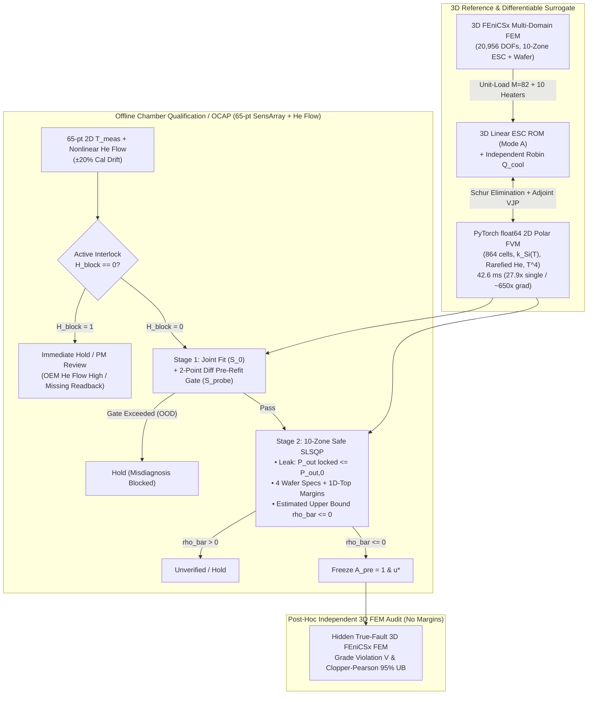
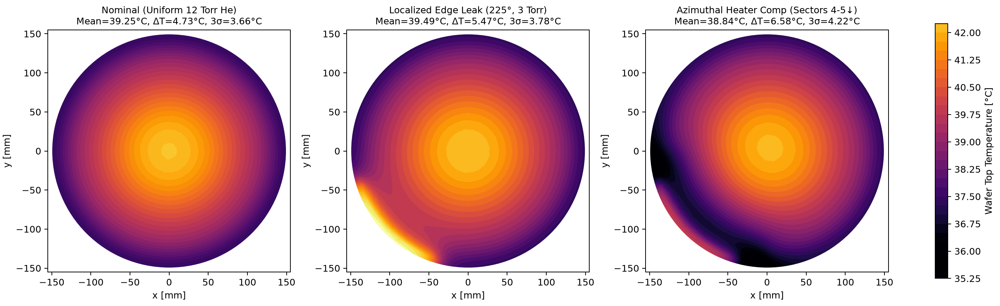
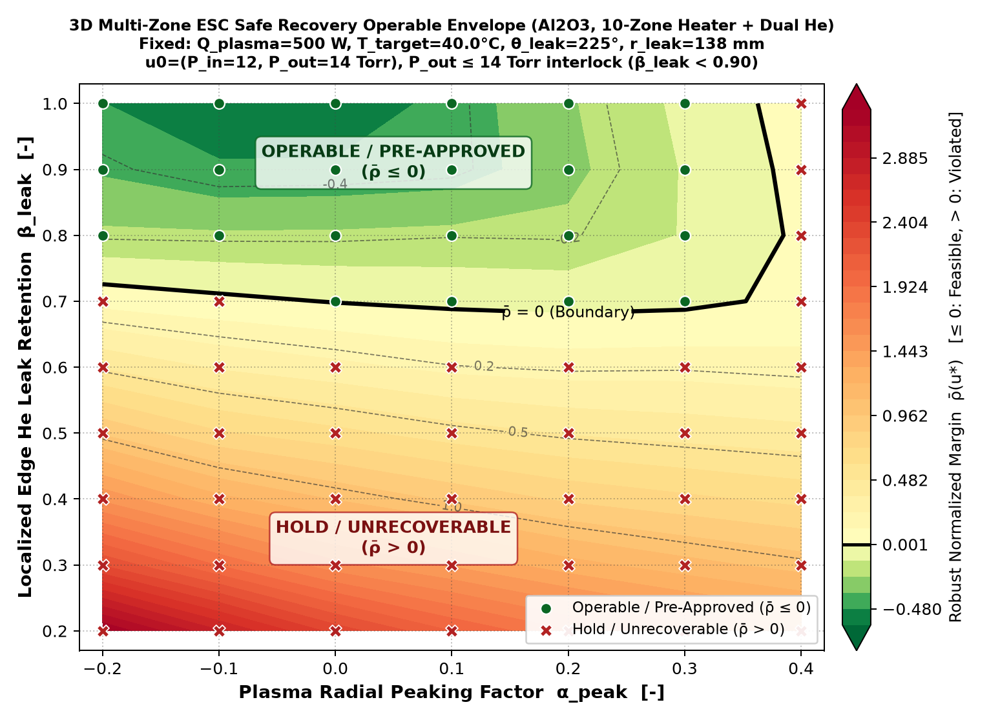
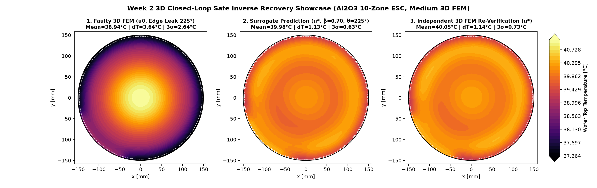

# 3D Plasma Etch ESC Differentiable Physics Surrogate & Safe Fault-Recovery Pipeline

**300 mm 플라즈마 식각 챔버의 3D 정전척(ESC) 열전달 대리 모델 · 오진 차단 진단(Pre-Refit Gate) · 10존 방위각 안전 역설계(Safe Inverse Recovery)**

> **한 줄 요약:** 300 mm 10존 방위각 ESC(내부 2존 + 외곽 45° 8섹터)의 **3D FEniCSx 멀티도메인 열전달 해석기**를 기준으로, 선형 3D ESC 열응답(Mode A ROM)과 PyTorch `float64` **2D 극좌표 $(r, \theta)$ 미분 가능 웨이퍼 FVM 레이어**를 양방향 결합(Adjoint Implicit Differentiation)한 **Differentiable Physics / Hybrid ROM–FVM** 파이프라인입니다. 무선 TC 웨이퍼(65점 2D SensArray) 기반 **오프라인 PM/챔버 매칭 및 OCAP 오토튜닝**을 타깃으로 하며, **2-운전점 차분 Pre-Refit 게이트**로 미모델링 OOD 오진을 차단하고 현장 인터락 하에서 안전 보정 레시피를 도출해 **독립 3D FEniCSx FEM으로 사후 검증**합니다. *(상세 보고서: [docs/DETAILED_RESULTS_REPORT.md](docs/DETAILED_RESULTS_REPORT.md) | `Soft-PINN` 및 `Neural ESC(Mode B)` 학습 비교는 Phase 2-A 예정)*

---

## 📚 이론 학습 가이드 (기계공학과 학부 4학년 눈높이)

이 프로젝트의 열전달·수치해석·Adjoint·역문제·통계 검증 배경을 직관적 비유와 실제 코드·그래프 1:1 해설로 정리한 7챕터 가이드입니다. (**[전체 학습 로드맵 및 체크리스트 열기 →](docs/study_guide/README.md)**)

* **[Ch 1. 큰 그림 먼저 잡기](docs/study_guide/ch01.md)** — 3D 10존 ESC 열평형, 수동 보정의 한계, Phase 1 vs 2-A FAQ
* **[Ch 2. 반도체 ESC와 희박 헬륨](docs/study_guide/ch02.md)** — Kennard–Yovanovich($d+M(P)$), 누설 시 승압 금지(척킹·아킹)
* **[Ch 3. 속도 27배: ROM + 2D FVM](docs/study_guide/ch03.md)** — 선형 ESC 중첩(Mode A), $\text{Bi}_z \ll 1$, Schur 소거(대입법)
* **[Ch 4. 기울기 514배: Adjoint 미분](docs/study_guide/ch04.md)** — 유한차분(24회) vs 수반법(1회), `float64` & Gradcheck(`1.02e-9`)
* **[Ch 5. 역문제와 Pre-Refit 오진 차단](docs/study_guide/ch05.md)** — 정규화 오차($S_0, S_{\text{probe}}$), `test_15` 웨이퍼 휨 단독 차단
* **[Ch 6. 안전 역설계 & 통계 보증](docs/study_guide/ch06.md)** — SLSQP, Operable Envelope($\beta \ge 0.68$), $A_{\text{pre}}/V$, Clopper–Pearson(`4.31%`)
* **[Ch 7. PINN은 어디로 가는가?](docs/study_guide/ch07.md)** — `MLP` vs `Soft-PINN` vs `Hybrid Mode A/B` & Phase 2-A/2-B 로드맵
* **[Appendix. 치트시트 & 면접 예상 질문 5선](docs/study_guide/appendix.md)** — 핵심 용어 2줄 사전 · SSOT 수치 암기표 · 면접 답변 틀

---

## 1. 시스템 아키텍처 (End-to-End Pipeline)



---

## 2. 3D 멀티도메인 물리 모델 (`src/fem3d/`)

* **6층 Conformal 3D 프리즘 메시 (`build_esc_3d_mesh.py`):**
  1. Al 칠러 냉각 베이스 ($R = 160\text{ mm}, t = 15.0\text{ mm}$, 하부 선형 Robin BC)
  2. ESC 세라믹 유전체 ($\text{Al}_2\text{O}_3$, $R = 155\text{ mm}, t = 2.0\text{ mm}$, 외벽 단열)
  3. **10존 매립 히터** (AMAT US10332772B2 구조 반영: Center $[0, 55]\text{ mm}$, Mid $[55, 110]\text{ mm}$, **외곽 8개 45° 방위각 섹터** $[110, 150]\text{ mm}$)
  4. $10\ \mu\text{m}$ 희박 He 미세 간극 (Kennard–Yovanovich 모델 + $C^2$ Quintic Hermite 국소 방위각 누설 $\beta_{\text{leak}} \in [0.05, 1.0]$)
  5. 300 mm 실리콘 웨이퍼 ($t = 775\ \mu\text{m}$, 비선형 $k_{\text{Si}}(T) = 148(300/T)^{1.3}$, 상면·측면 진공 복사 $T^4$)


*3D Day 1 벤치마크: 좌하단 225° 국소 에지 He 누설($12 \to 3\text{ Torr}$) 시 `+5.85°C` 핫스팟이 발생하며, 수동으로 해당 방위각 섹터(4·5번)만 줄이면 누설 안쪽이 과냉각되어 오히려 $\Delta T$가 악화(`5.47°C → 6.58°C`)됨을 확인.*

---

## 3. 핵심 검증 결과

### 3.1 Step 1 — 3D 하이브리드 대리 모델 정합성 · 에너지 보존 · Adjoint Gradcheck
(`medium` 3D 메시: 20,956 DOFs, 119,765 요소, [step1_3d_hybrid_verify.json](results/benchmarks/step1_3d_hybrid_verify.json))

| 검증 항목 | 측정 결과 | 비고 |
| :--- | :--- | :--- |
| **정상(Nominal) 3D FEM 정합** | `T_waf` **MAE `0.041°C`** (max `0.123°C`)<br/>`T_esc` **MAE `0.023°C`** (max `0.188°C`) | 2D 극좌표 FVM(864셀) + Mode A(M=82) |
| **225° 국소 누설(`β=0.25`) 정합** | `T_waf` **MAE `0.063°C`** (max `0.357°C`)<br/>`T_esc` **MAE `0.026°C`** (max `0.211°C`) | 급격한 2 mm 국소 누설 경계 포함 |
| **전역 에너지 보존 (2중 검산)** | 웨이퍼 **`1.14e-13 W`**, 독립 ESC→칠러 **`≤ 9.09e-13 W`** | 원통좌표 면적 가중 $L^2$ 투영 + Watt 정규화 |
| **Adjoint 구현 Gradcheck (vs FVM FD)** | 6개 변수 전체 최대 상대오차 **`1.02e-9`** | `torch.float64` + 1-shot `linalg.solve` VJP |
| **3D FEM 감도 검증 (vs 3D FEM FD)** | `Q_1`: **0.46%**, `Q_7`: **0.77%**, `P_out`: **1.56%**, `β_leak`: **8.19%** | 3D DG0 메시 2 mm 경사 이산화 차이 반영 |
| **1-스텝 실측 속도 (배치 1, 워밍업 후)** | Forward **`45.63 ms`** / **Fwd+12D Bwd `57.29 ms`** | 워밍업 3D FEM `1,228.2 ms` 대비 **26.9×** (12D 중앙유한차분 **514.5×**) |

### 3.2 Phase 1.5 — 대규모 독립 87건 3D FEM 배치 검증 & Operable Envelope 2D 맵
전용 캘리브레이션(8건)에서 잠근 문턱(`S_0 = 107.154`, `S_probe = 170.972`)을 고정한 채 **독립 87건 3D FEM 배치**([phase15_verification_suite.json](results/benchmarks/phase15_verification_suite.json))를 평가했습니다:
* **조건부 오승인율 $\hat{P}(V=1 \mid A_{\text{pre}}=1)$:** **`0 / 68 = 0.00%`** (단측 95% Clopper–Pearson 신뢰상한 = **`0.0431` < 5% 달성!**)
* **안전 게이트 차단율:** 활성 $H_{\text{block}}$ **`4/4 (100%)`**, 숨겨둔 OOD **`6/6 (100%)`**, 극심 누설(`β=0.15~0.38`) **`5/5 (100%)`**
* **복구 가능 경계 (63pt Operable Envelope):** $\alpha_{\text{peak}} \in [0, 0.30]$ 구간에서 **$\beta_{\text{leak}} \ge 0.68$** (최대 ~32% 국소 에지 압력 강하)까지 승압 없이 안전 복구 가능



### 3.3 Step 2 — 초기 15건 상세 감사표 (`A_pre` vs `V`) & 대표 복구 쇼케이스
전용 캘리브레이션 세트(8건)에서 게이트 문턱(`S_0 = 107.15`, `S_probe = 170.97`)을 고정한 뒤, **완전 독립 테스트 세트 15건**에서 장비 정보만으로 `A_pre`와 `u*`를 동결하고 숨겨둔 실제 3D FEM 원규격(마진 미포함)으로 `V`를 사후 채점했습니다. ([week2_3d_closed_loop_eval.json](results/benchmarks/week2_3d_closed_loop_eval.json))

* **조건부 오승인율 $\hat{P}(V=1 \mid A_{\text{pre}}=1)$:** **`0 / 7 = 0.00%`** (단측 95% Clopper–Pearson 신뢰상한 = **`0.3482`**)
* **승인율:** 전체 `7/15 (46.7%)`, 복구 가능 인모델 `7/8 (87.5%)`
* **활성 인터락($H_{\text{block}}$) 차단:** **`2/2 (100%)`** | **숨겨둔 OOD 외란 차단:** **`4/4 (100%)`**

| Case | Category | `H_block` | `S_0` | `S_probe` | `A_pre` | Post-Hoc `V` | 판정 및 핵심 근거 |
| :--- | :--- | :---: | ---: | ---: | :---: | :---: | :--- |
| `test_01_nominal` | `in_model` | 0 | 53.0 | 119.5 | **1** | **0** | `Pre-Approved` (FEM 통과) |
| `test_02_peak_mod` | `in_model` | 0 | 79.9 | 113.7 | **1** | **0** | `Pre-Approved` (FEM 통과) |
| `test_03_peak_edge` | `in_model` | 0 | 44.2 | 89.9 | **1** | **0** | `Pre-Approved` (FEM 통과) |
| `test_04_power_high` | `in_model` | 0 | 60.2 | 113.8 | **1** | **0** | `Pre-Approved` (FEM 통과) |
| `test_05_leak_mild_45` | `in_model` | 0 | 61.6 | 97.6 | **1** | **0** | `Pre-Approved` (FEM 통과) |
| `test_06_leak_mod_135` | `in_model` | 0 | 60.4 | 92.4 | **1** | **0** | `Pre-Approved` (FEM 통과) |
| `test_07_leak_mod_315` | `in_model` | 0 | 61.9 | 77.2 | **0** | — | `Hold` ($\overline{\rho}=+0.025 > 0$, 보수 마진 경계) |
| `test_08_leak_225_show` | `in_model` | 0 | 45.4 | 71.2 | **1** | **0** | **`Pre-Approved` (아래 300mm 쇼케이스)** |
| `test_09_leak_sev_hold` | `in_model_unrec` | 0 | 44.8 | 61.5 | **0** | — | `Hold` ($\beta=0.25$ 극심 누설, $\overline{\rho}=+1.599$) |
| `test_10_hblock_heflow` | `h_block` | **1** | — | — | **0** | — | `Hold / PM Review` (OEM He Flow `23.2 sccm`) |
| `test_11_hblock_readback` | `h_block` | **1** | — | — | **0** | — | `Hold / PM Review` (Readback 누락) |
| `test_12_ood_hotspot_225` | `ood` | 0 | **307.8** | 118.4 | **0** | — | `Hold` (`S_0` 초과 — 방위각 플라즈마 핫스팟 차단) |
| `test_13_ood_hotspot_60` | `ood` | 0 | **276.7** | 113.1 | **0** | — | `Hold` (`S_0` 초과 — 방위각 플라즈마 핫스팟 차단) |
| `test_14_ood_shift_rleak` | `ood` | 0 | **199.0** | 131.7 | **0** | — | `Hold` (`S_0` 초과 — 이동 누설 $r=128\text{ mm}$ 차단) |
| **`test_15_ood_warpage`** | **`ood`** | **0** | **77.3** | **479.3** | **0** | — | **`Hold` (단일점 `S_0` 통과 → Pre-Refit `S_probe`가 단독 차단!)** |


*대표 복구 쇼케이스(`test_08_leak_225_show`, $\beta=0.70, \theta=225^\circ$, 누설 인터락으로 $P_{\text{out}}$ 승압 금지): 독립 3D FEniCSx FEM 재해석 기준 $\Delta T$ **`3.64°C → 1.14°C` (-68.6%)**, $3\sigma$ **`2.64°C → 0.73°C` (-72.2%)**, $\bar{T}$ **`38.94°C → 40.05°C`** (목표 `40.0°C`).*

---

## 4. 디렉터리 구조 및 재현 방법

```text
pinn-recovery-surrogate-model/
├── README.md
├── .gitignore
├── environment.yml
├── docs/
│   ├── pipeline_v1_7.md                   # 10/10 Binary Gate GO 승인 설계 명세서
│   └── 식각 ESC 열적 이상 파이프라인.docx     # 300mm HVM 양산 팹 리서치 참고 자료
├── src/
│   ├── physics/materials_and_he.py        # Si/Al2O3/AlN/Al 물성 & Kennard-Yovanovich 모델
│   ├── fem3d/
│   │   ├── build_esc_3d_mesh.py           # Gmsh 3D 6층 Conformal 프리즘 메시 (10존 히터)
│   │   └── esc_3d_fem_solver.py           # FEniCSx 0.11.0 3D 비선형 솔버
│   ├── rom/
│   │   └── esc_3d_unit_load.py            # Mode A 3D 선형 ESC 단위하중 ROM + 독립 Robin Q_cool
│   ├── solvers/
│   │   └── coupled_3d_wafer_fvm.py        # PyTorch float64 2D Polar FVM + Adjoint Newton
│   └── inverse/
│       ├── stage1_3d_diagnosis.py         # 65점 SensArray + 유량 Mismatch + Pre-Refit 게이트
│       └── stage2_3d_recovery.py          # 10존 안전 제약 SLSQP + 추정 상계 rho_bar + A_pre
├── benchmarks/
│   ├── day1_3d_fem_benchmark.py           # 3D FEM 단건 속도 · 에너지 수지 · 컬러맵 데모
│   ├── step1_3d_hybrid_verify.py          # 3D FEM 정합 · 에너지 보존 · Adjoint Gradcheck
│   └── week2_3d_closed_loop_eval.py       # 캘리브레이션 + 독립 15건 3D FEM 폐루프 시험표
└── results/
    └── benchmarks/                        # 검증 JSON 리포트 및 300mm 웨이퍼 시각화 PNG
```

### 재현 실행 커맨드 (WSL2 Ubuntu + Conda `silicon-heat`)
```bash
conda activate silicon-heat
cd pinn-recovery-surrogate-model

# 1. 3D 메시 생성 및 3D FEM 단건 벤치마크
python benchmarks/day1_3d_fem_benchmark.py

# 2. 3D Mode A ESC ROM 추출 및 PyTorch 2D Polar FVM + Adjoint Gradcheck 검증
python -m src.rom.esc_3d_unit_load
python benchmarks/step1_3d_hybrid_verify.py

# 3. 독립 15건 3D FEM 폐루프 진단 · 안전 역설계 · 쇼케이스 컬러맵 생성
python benchmarks/week2_3d_closed_loop_eval.py
```

---

## 5. 향후 확장 로드맵 (Phase 2)
* **2단 성적표 4종 Ablation:** 동일 3D LHS 데이터 기반 `Data-only MLP` vs `Soft-PINN` vs `Linear ESC (POD+Ridge) + Diff-FVM` vs `Neural ESC (Mode B) + Diff-FVM` 비교 (비평형 계면 방향미분 및 저압 외삽 검증)
* **$\text{Al}_2\text{O}_3$ vs $\text{AlN}$ 3D 소재 비교:** 동일 파이프라인에 $\text{AlN}$($160\text{ W/m}\cdot\text{K}$) 적용 시 방위각 열간섭(Crosstalk) 및 복구 가능 영역 변화 정량화
