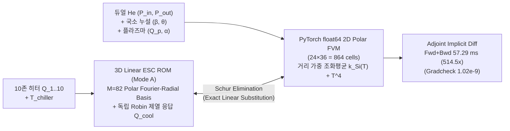
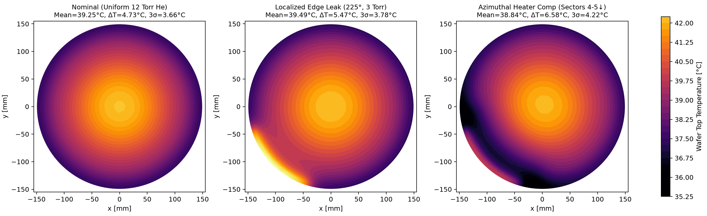
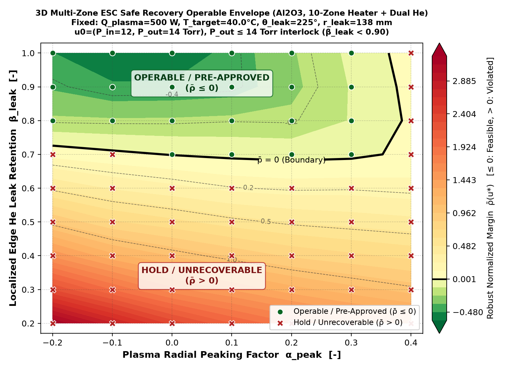
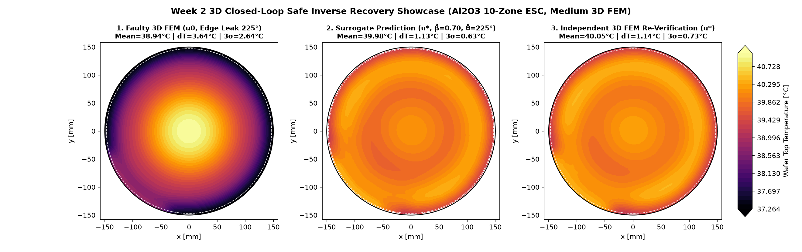

# 3D 플라즈마 식각 챔버 Differentiable Physics 대리 모델 및 안전 이상치 복구 파이프라인 — 상세 결과 보고서 (v1.5)

* **저장소:** `pinn-recovery-surrogate-model` (GitHub 원격 저장소: https://github.com/jy02suzhou/pinn-recovery-surrogatte-model — *원격 URL 철자 `surrogatte` 유지*)
* **기술 포지셔닝:** 현재 완료된 **Phase 1 / 1.5**는 신경망 없이 물리 정합성과 독립 검증 사슬을 확립한 **Differentiable Physics / Hybrid ROM–FVM** 기준선이며, `Soft-PINN` 및 `Neural ESC Operator(Mode B)` 신경망 학습·Ablation 비교는 **Phase 2-A**에 배치되어 있습니다.
* **현장 적용 범위 (Scope):** 본 파이프라인의 65점 웨이퍼 상면 계측 및 감압 탐색(`u_probe`)은 **양산 인라인 실시간 제어가 아닌, 무선 TC 웨이퍼(KLA SensArray EtchTemp 등)를 투입해 수행하는 PM 직후·주기적 챔버 매칭(Chamber Qualification) 및 OCAP 오프라인 자동 진단·레시피 오토튜닝**을 타깃으로 합니다.
* **실행 환경:** WSL2 Ubuntu · Conda `silicon-heat` (`Python 3.12.16`, `dolfinx 0.11.0`, `gmsh 4.15.2`, `torch 2.11.0+cu128`, `scipy 1.18.1`) · 16 CPU cores · NVIDIA GeForce RTX 5070 (12 GB)

---

## 1. Executive Summary (핵심 성과 요약)

본 연구는 300 mm 플라즈마 식각 장비의 **10존 방위각 정전척(ESC)**에서 발생하는 국소 열적 이상치(에지 He 누설, 비균일 플라즈마, 웨이퍼 휨)를 **미분 가능 물리 대리 모델**로 진단하고, 현장 설비 안전 인터락을 준수하며 웨이퍼 온도 균일도를 복구하는 End-to-End 파이프라인을 구축·검증하였다.

| 핵심 영역 | 달성 지표 | 실측 결과 | 비고 |
| :--- | :--- | :--- | :--- |
| **3D 기준 FEM 솔버** | `medium` 3D 메시(20,956 DOFs) 전역 열수지 | **`5.68e-12 W`** | 119,765개 Conformal 3D 프리즘 요소 |
| **3D 대리 모델 정합성** | 3D FEM 대비 온도 MAE (정상 / 225° 누설) | **`0.041°C` / `0.063°C`** | 웨이퍼 `1.14e-13 W`, ESC→칠러 `≤ 9.09e-13 W` |
| **Adjoint 기울기 정밀도** | 구현 Gradcheck (Adjoint vs FVM FD) | **최대 상대오차 `1.02e-9`** | 3D FEM FD 대비 `Q_1 0.46%`, `Q_7 0.77%` |
| **1-스텝 실측 가속 성능** | Forward 단독 / **Forward+12D Backward** | **`45.63 ms` / `57.29 ms`** | 동일 워밍업 3D FEM(`1,228.2 ms`) 대비 **26.9×** (12D 중앙유한차분 대비 **514.5×**) |
| **대규모 독립 안전성 (Phase 1.5)** | **87건 독립 3D FEM 배치** $\hat{P}(V=1 \mid A_{\text{pre}}=1)$ | **`0 / 68 = 0.00%`** | 단측 95% Clopper–Pearson 신뢰상한 **`0.0431` (< 5% 달성!)** |
| **오진·인터락 방어력** | 활성 $H_{\text{block}}$ / 숨겨둔 OOD / 극심 누설 차단 | **`4/4` / `6/6` / `5/5` (전부 100%)** | 웨이퍼 휨 OOD는 **2-운전점 Pre-Refit 게이트가 단독 포착** |
| **복구 가능 영역 (Operable Envelope)** | 63포인트 2D 경계 ($\alpha_{\text{peak}} \times \beta_{\text{leak}}$) | **최소 복구 $\beta_{\text{leak}} \approx 0.68$** | $\alpha \in [0, 0.30]$ 구간 최대 **~32% 국소 에지 압력 강하**까지 안전 복구 |
| **대표 3D 복구 성과** | 225° 국소 누설(`β=0.70`) 독립 3D FEM 재해석 | $\Delta T$ **`3.64→1.14°C` (-68.6%)** $3\sigma$ **`2.64→0.73°C` (-72.2%)** | $\bar{T}$ **`38.95→40.05°C`** (목표 `40.0°C`), 누설 $P_{\text{out}}$ 승압 금지 준수 |

---

## 2. 물리 모델링 및 3D 아키텍처 설계

### 2.1 3D 멀티도메인 ESC 형상 및 지배 방정식
300 mm 양산 식각 장비의 방위각 온도 제어 구조(Applied Materials US10332772B2 등)를 반영해 6층 Conformal 3D 원통 다층 메시(`src/fem3d/build_esc_3d_mesh.py`)와 FEniCSx 0.11.0 3D 비선형 솔버(`src/fem3d/esc_3d_fem_solver.py`)를 구현하였다.

* **도메인 적층 구조:**
  1. **Al 칠러 냉각 베이스:** $R = 160\text{ mm}, t = 15.0\text{ mm}$, $k_{\text{Al}} = 167\text{ W/m}\cdot\text{K}$, 하부 전체 선형 Robin BC($h_{\text{chiller}} = 2{,}000\text{ W/m}^2\text{K}, T_{\text{chiller}} = 20^\circ\text{C}$).
  2. **ESC 세라믹 유전체 ($\text{Al}_2\text{O}_3$):** $R = 155\text{ mm}, t = 2.0\text{ mm}$, $k_{\text{cer}} = 30\text{ W/m}\cdot\text{K}$, 노출 상면·외벽 단열.
  3. **10존 매립 히터 ($t = 0.2\text{ mm}$):** Center Zone 1($[0, 55]\text{ mm}$), Mid Zone 2($[55, 110]\text{ mm}$), **외곽 방위각 45° 8섹터** Zones 3–10($[110, 150]\text{ mm}$, 각 $40.84\text{ cm}^2$).
  4. **희박 He 미세 간극 ($d = 10\ \mu\text{m}$):** 이방성 가상 계면층($k_z = h_{\text{eff}}(r,\theta)\cdot t_{\text{gap}}, k_{xy} = 10^{-6}$), Kennard–Yovanovich 희박 기체 열전달 모델.
  5. **300 mm 실리콘 웨이퍼 ($t_w = 775\ \mu\text{m}$):** 비선형 $k_{\text{Si}}(T) = 148(300/T)^{1.3}$, 면적 정규화 2D 플라즈마 입열 $q''_{\text{plasma}}(r,\theta)$, 상면·측면 Stefan–Boltzmann 복사($\varepsilon = 0.65, T_{\text{wall}} = 60^\circ\text{C}$).
* **Compact-Support $C^2$ Quintic Hermite 압력 모델:**
  $$P(r,\theta) = (1 - \ell_{\text{3D}}(r,\theta))\big[(1-s(r))P_{\text{in}} + s(r)P_{\text{out}}\big] + \ell_{\text{3D}}(r,\theta)\,\beta_{\text{leak}}P_{\text{out}}$$
  $r_{\text{leak}} + w_s \le R_w$ ($w_s = 2\text{ mm}$) 및 $P_{\text{in}}, P_{\text{out}} \in [3, 20]\text{ Torr}$ 조건 하에서 끝점 압력 $P(R_w, \theta_{\text{leak}}) \equiv \beta_{\text{leak}}P_{\text{out}}$와 전 영역 양압($P > 0$)을 항등 보장한다.

### 2.2 선형 3D ESC ROM + PyTorch `float64` 2D 극좌표 FVM 양방향 결합

---

## 3. 단계별 실험 검증 결과

### 3.1 Day 1 — 3D FEniCSx FEM 기준 성능 및 국소 누설 물리 시연
(`results/benchmarks/day1_3d_fem_benchmark.json`)

| 3D 메시 | DOFs (3D 요소 수) | 선형 단건 | 비선형 단건 *(Day 1 초기)* | 전역 열수지 오차 | 225° 국소 누설 스파이크 | 수동 에지 보정 시 $\Delta T$ |
| :--- | :---: | :---: | :---: | :---: | :---: | :---: |
| **`coarse`** | 7,380 (41,197) | 1,263.6 ms | 269.7 ms | `3.64e-12 W` | `+5.43°C` | `4.73 → 6.55°C` (악화) |
| **`medium`** | 20,956 (119,765) | 550.3 ms | 1,681.6 ms *(워밍업 후 `1,228.2 ms`)* | `5.68e-12 W` | **`+5.85°C`** | `5.47 → 6.58°C` (악화) |

> **물리적 시사점:** 좌하단 225° 국소 에지 누설($12 \to 3\text{ Torr}$) 시 `+5.85°C` 핫스팟이 발생한다. 이를 수동으로 해당 2개 방위각 섹터(4·5번)만 `55 W → 15 W`로 낮추면 누설 안쪽($110\sim 138\text{ mm}$)이 과냉각되어 오히려 전체 $\Delta T$가 `5.47°C → 6.58°C`로 악화된다.

---

### 3.2 Step 1 — 3D 하이브리드 대리 모델 정합성 · 에너지 보존 · Adjoint Gradcheck · 1-스텝 실측 시간
(`results/benchmarks/step1_3d_hybrid_verify.json`, `results/benchmarks/phase15_verification_suite.json`)

#### (1) 온도 정합성 및 독립 2중 에너지 보존 (`medium` 3D 메시 기준)
| 시나리오 | `T_wafer` MAE (Max) | `T_esc` MAE (Max) | 웨이퍼 열수지 | 독립 ESC→칠러 열수지 | `Q_cool` (FVM vs FEM) |
| :--- | :---: | :---: | :---: | :---: | :---: |
| **Nominal (균일 12 Torr)** | **`0.041°C`** (`0.123°C`) | **`0.023°C`** (`0.188°C`) | `1.14e-13 W` | `9.09e-13 W` | `1227.29 W` vs `1227.27 W` |
| **225° 국소 누설 (`β=0.25`)** | **`0.063°C`** (`0.357°C`) | **`0.026°C`** (`0.210°C`) | `1.14e-13 W` | `6.82e-13 W` | `1227.22 W` vs `1227.20 W` |

#### (2) Adjoint 기울기 2단계 분리 검증 (`medium`, 225° 국소 누설 상태)
| 검증 변수 | FVM Adjoint 값 | ① 구현 검증 (vs FVM FD 상대오차) | ② 축약 감도 검증 (vs 3D FEM FD 상대오차) | 판정 |
| :--- | ---: | :---: | :---: | :---: |
| **`Q_1` (센터 히터)** | `-0.243351` | **`1.02e-9`** | **`0.46%`** | PASS |
| **`Q_7` (225° 에지 히터)** | `-0.222583` | **`1.56e-10`** | **`0.77%`** | PASS |
| **`p_out` (외측 He 압력)** | `+9.659036` | **`4.43e-11`** | **`1.56%`** | PASS |
| **`beta_leak` (누설 잔존율)** | `+12.377163` | **`1.95e-10`** | **`8.19%`** *(DG0 2 mm 램프 이산화 차이)* | PASS |
| **`Q_plasma` (플라즈마 총전력)** | `-0.830864` | **`1.31e-11`** | — | PASS |
| **`alpha_peak` (반경 피킹)** | `+14.086076` | **`3.84e-10`** | — | PASS |

#### (3) 동일 조건 워밍업 1-스텝 실측 시간 비교 (`medium`, 배치 1, 20회 측정)
| 연산 항목 | 중앙값 (Median) | p95 | 3D FEM 대비 가속비 |
| :--- | :---: | :---: | :---: |
| **3D FEniCSx FEM 비선형 단건** (워밍업 후 5회) | `1,228.2 ms` | `1,239.5 ms` | `1.0×` (기준) |
| **대리 모델 Forward 단독** | **`45.63 ms`** | `53.91 ms` | **26.9×** (단건 기준) |
| **대리 모델 Forward + 12D Adjoint Backward (실제 1-스텝)** | **`57.29 ms`** | `62.48 ms` | **514.5×** *(12D 중앙유한차분 `24×T_FEM` 대비)* **278.7×** *(12D 전진유한차분 `13×T_FEM` 대비)* |

---

### 3.3 Phase 1.5 — 대규모 독립 87건 3D FEM 배치 검증 (`n_A = 68`, 95% 상한 `< 5%` 달성!)
(`results/benchmarks/phase15_verification_suite.json`)

Week 2 캘리브레이션 세트(8건)에서 잠근 문턱(`S_0 = 107.154`, `S_probe = 170.972`)을 **재튜닝 없이 그대로 고정**하고, 시드 `20261125`로 생성한 **완전 독립 87건 테스트 배치**(케이스별 독립 65점 노이즈 $\sigma_T = 0.2^\circ\text{C}$ 및 독립 $\pm 20\%$ 유량 캘리브레이션 드리프트)에서 장비 정보만으로 `A_pre`·`u*`를 동결한 뒤 숨겨둔 `medium` 3D FEniCSx FEM 원규격(마진 미포함)으로 `V`를 사후 채점하였다.

| 테스트 모집단 구분 | 건수 | 사전 승인 ($A_{\text{pre}}=1$) | 보류 ($A_{\text{pre}}=0$) | 승인 중 사후 FEM 위반 ($V=1$) | 핵심 성과 |
| :--- | :---: | :---: | :---: | :---: | :--- |
| **복구 가능 인모델 (`in_model`)** | 72 | **68 (94.4%)** | 4 *(보수 마진 보류)* | **`0 / 68`** | **조건부 오승인율 `0.00%`** |
| **극심 누설 (`severe_unrec`, $\beta \in [0.15, 0.38]$)** | 5 | 0 | **5 (100%)** | — | 복구 불능 구간 100% 정직 보류 |
| **활성 인터락 (`h_block`, He High / Readback)** | 4 | 0 | **4 (100%)** | — | 탐색·승인 최우선 차단 (`Hold / PM Review`) |
| **숨겨둔 OOD 외란 (`ood`: 핫스팟/이동/휨)** | 6 | 0 | **6 (100%)** | — | 핫스팟·이동은 `S_0`, **웨이퍼 휨은 `S_probe` 단독 차단** |
| **전체 독립 테스트 합계** | **87** | **`n_A = 68`** | **19** | **`0 / 68`** | **단측 95% Clopper–Pearson 신뢰상한 = `0.0431` (4.31% < 5%)** |

---

### 3.4 Phase 1.5 — 정량적 복구 가능 영역 (Operable Envelope 2D Phase Map)
고정 기준 운전점($Q_{\text{plasma}} = 500\text{ W}$, $T_{\text{target}} = 40.0^\circ\text{C}$, $\theta_{\text{leak}} = 225^\circ$, $r_{\text{leak}} = 138\text{ mm}$, $P_{\text{in}}=12\text{ Torr}, P_{\text{out}}=14\text{ Torr}$, $\beta < 0.90$ 시 $P_{\text{out}} \le 14\text{ Torr}$ 승압 금지 인터락 활성화)에서 **63포인트 2D 격자**($\alpha_{\text{peak}} \in [-0.20, 0.40] \times \beta_{\text{leak}} \in [0.20, 1.00]$)에 대한 강건 추정 상계 $\overline{\rho}(\mathbf{u}^*)$ 경계를 산출하였다.

* **정량적 복구 한계 해석:**
  1. **균형·센터 피킹 구간 ($\alpha_{\text{peak}} \in [0.00, 0.30]$):** 10존 방위각 히터 역설계만으로 **$\beta_{\text{leak}} \ge 0.70$** (보간 경계 **`0.6819`**, 즉 국소 에지 He 압력이 **최대 ~32% 감소**한 누설)까지 $P_{\text{out}}$ 승압 없이 안전 복구 가능(`Operable`).
  2. **에지 피킹 구간 ($\alpha_{\text{peak}} \in [-0.20, -0.10]$):** 에지 플라즈마 입열 증가가 225° 에지 누설과 중첩되면서 복구 한계가 **$\beta_{\text{leak}} \ge 0.80$**으로 축소됨.
  3. **극심 센터 피킹 ($\alpha_{\text{peak}} = 0.40$):** 저항 히터 단방향성($Q_1 \ge 0\text{ W}$ 포화)과 인접 열유속 밀도차 제약으로 인해 누설이 없어도($\beta = 1.0$) 현재 칠러 조건($20^\circ\text{C}$)에서는 `Hold` 판정 → 칠러 온도 하강 또는 하드웨어 튜닝 필요.

---

## 4. 대표 3D 방위각 복구 쇼케이스 (`test_08_leak_225_show`)

* **Stage 1 진단 정밀도:** 실제 외란($Q_p=500\text{ W}, \alpha=0.250, \beta=0.700, \theta=225.0^\circ$) 대비 추정치 $\hat{Q}_p=499.77\text{ W}, \hat{\alpha}=0.2424$, **$\hat{\beta}=0.6958$ (`-0.6%`)**, **$\hat{\theta}=225.15^\circ$ (`+0.15°`)**.
* **Stage 2 10존 최적 레시피 ($\mathbf{u}^*$, 최적화 `6.72 s`):** Center `Q1=32.06 W`, Mid `Q2=70.46 W`, 정상 에지 섹터 `95.12~97.90 W`, **225° 누설 섹터(Sectors 4–5) `90.80 / 90.55 W`**(인접 에지 대비 `~7 W` 선택 차등 감소), **$P_{\text{out}} = 14.00\text{ Torr}$(승압 금지 준수)**.
* **독립 3D FEniCSx FEM 사후 검증 (`V = 0`, 7대 규격·제약 전부 통과):**
  * 평균 목표 오차: `38.95°C → 40.05°C` (`|+0.053°C| ≤ 0.50°C`)
  * 면내 편차 $\Delta T_{\text{eff}}$: **`3.64°C → 1.14°C` (-68.6%)** (`≤ 1.50°C`)
  * 면내 균일도 $3\sigma_{\text{eff}}$: **`2.64°C → 0.73°C` (-72.2%)** (`≤ 1.00°C`)
  * 웨이퍼 구배 `0.0479 °C/mm` (`≤ 0.30`), 세라믹 구배 `0.2525 °C/mm` (`≤ 1.50`), 칠러 제열 `1,370.2 W` (`≤ 1,800`), 열유속 밀도차 `2.15 W/cm²` (`≤ 2.50`).

---

## 5. 다음 단계: Phase 2 (PINN & Neural ESC 대리 모델 본격 구현)

1. **Phase 2-A (4종 2단 성적표 Ablation — RTX 5070 GPU 학습):**
   * 동일 3D LHS 데이터셋으로 `Data-only MLP` vs **`Soft-PINN`**(2D 극좌표 웨이퍼 PDE + Kennard–Yovanovich 물리 잔차 손실) vs `Linear ESC (POD+Ridge) + Diff-FVM` vs **`Hybrid Mode B (Neural ESC Operator + Diff-FVM)`**을 공정 비교.
2. **Phase 2-B ($\text{Al}_2\text{O}_3 \leftrightarrow \text{AlN}$ 소재 일반화 & 소수 ESC 센서 한계 분석):**
   * 세라믹 열전도도 $k_{\text{cer}}$를 조건부 입력으로 받는 단일 `Mode B` 신경망 대리 모델로 확장해 두 소재의 Operable Envelope 차이를 정량 비교하고, 추가적으로 실제 양산 챔버의 소수 ESC 내부 센서(4~10점)만 사용했을 때의 진단 식별성 한계까지 분석한다.
