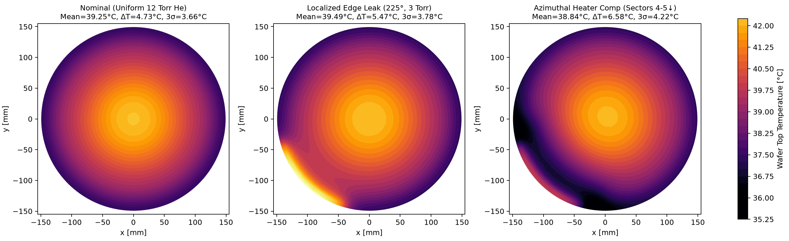

# Chapter 1. 큰 그림 먼저 잡기: 우리가 도대체 무엇을 만들었는가?

## 1. 학습 목표 및 출발점

학부 열전달의 전도·대류($q'' = h\Delta T$)와 자동제어의 다변수(MIMO) 개념을 반도체 식각 장비의 **300 mm 3D 다중 존 ESC**로 확장합니다. 본 장을 마치면 에지 헬륨(He) 누설이 국소 핫스팟을 만드는 이유와 단순 수동 보정이 온도 균일도를 악화시키는 원인을 물리·코드·그래프로 설명할 수 있습니다.

## 2. 핵심 개념 (3-Step 전개)

### 2.1 3D 다중 존 ESC 열평형과 국소 에지 He 누설

**① 직관 비유 (집 안의 3중 열평형)**  
300 mm 실리콘 웨이퍼($R_w = 150\text{ mm}$, $t_w = 775\ \mu\text{m}$)가 놓인 ESC는 **천장 플라즈마 + 방바닥 보일러 + 지하실 칠러**의 열평형 시스템입니다.
- **천장 플라즈마:** 상면에서 $Q_{\text{plasma}} = 500\text{ W}$의 열을 투입합니다.
- **지하실 칠러:** 하부 알루미늄 베이스를 20°C로 냉각합니다.
- **방바닥 10존 보일러($Q_1 \sim Q_{10}$):** 세라믹 내부 Center(Z1), Mid(Z2), 외곽 45° 8섹터(Z3~Z10) 히터로 $T_{\text{target}} = 40.0^\circ\text{C}$를 맞춥니다.
- **백사이드 He 간극:** $d = 10\ \mu\text{m}$ 틈에 $P_{\text{in}}, P_{\text{out}} \in [3.0, 20.0]\text{ Torr}$의 He을 채워 열을 뺍니다. 에지($\theta_{\text{leak}}$) 실링이 깨지면($P_{\text{edge}} = \beta_{\text{leak}} P_{\text{out}}$), 그 자리만 단열된 듯 핫스팟이 솟습니다.

**② 핵심 수식 및 원리**  
정상상태 열전도와 He 간극 유효 열전달계수 $h_{\text{eff}}$는 다음과 같습니다.
$$\nabla \cdot \bigl(k_{\text{Si}}(T)\nabla T\bigr) = 0, \qquad h_{\text{eff}}(P) = h_{\text{solid}} + \frac{k_{\text{He}}}{d + M(P)}$$
$h_{\text{solid}} = 50\text{ W/m}^2\text{K}$는 고체 접촉항, $M(P) \propto 1/P$는 온도 점프 거리입니다. 누설로 압력이 낮아지면 $M(P)$가 커져 $h_{\text{eff}}$가 급감하고 웨이퍼 온도 $T_w$가 급등합니다.

**③ 실제 코드와 벤치마크 그래프 1:1 해설**  
3D FEM 격자 생성에 쓰이는 ESC 적층 규격(`src/fem3d/build_esc_3d_mesh.py:48-62`)입니다.

```python
class ESC3DGeometrySpec:
    """Geometric specification [meters] for 3D multi-zone ESC + 300 mm wafer."""
    r_z1: float = 0.055          # Inner center heater radius [m]
    r_z2: float = 0.110          # Middle ring heater outer radius [m]
    r_wafer: float = 0.150       # 300 mm wafer radius [m]
    r_esc: float = 0.155         # ESC ceramic outer radius [m]
    r_base: float = 0.160        # Al cooling base outer radius [m]

    t_base: float = 0.0150       # Al base thickness [m]
    t_cer_bot: float = 0.0009    # Ceramic below heater [m]
    t_heater: float = 0.0002     # Embedded heater layer thickness [m]
    t_cer_top: float = 0.0009    # Ceramic above heater [m] (total ceramic = 2.0 mm)
    t_gap_mesh: float = 0.0002   # Virtual He gap mesh thickness [m]
    t_wafer: float = 0.000775    # Silicon wafer thickness [m]
```

`medium` 격자(20,956 DOFs, 119,765 요소, 열수지 `5.68e-12 W`) 해석 결과입니다.



$x, y$ 축은 웨이퍼 좌표(`-150` ~ `+150 mm`), 컬러바는 상면 온도(`35.25` ~ `42.00°C`)입니다.
- **왼쪽(Nominal, 12 Torr He):** 축대칭 동심원 분포(`Mean=39.25°C`, `ΔT=4.73°C`, `3σ=3.66°C`).
- **가운데(Localized Edge Leak, 225°, 3 Torr):** 좌하단 225° 가장자리에 노란 핫스팟이 생겨 **`+5.85°C` 스파이크**가 발생합니다(`ΔT=5.47°C`, `3σ=3.78°C`).
- **오른쪽(Azimuthal Heater Comp, Sectors 4-5↓):** 225° 인접 히터 2개만 수동으로 낮추자 안쪽·주변이 `35.25°C` 부근으로 과냉각되어 **$\Delta T$가 `5.47°C → 6.58°C`로 악화**(`3σ`: `3.78°C → 4.22°C`)됩니다. 넓은 히터와 좁은 누설의 공간 불일치 때문에 3D 다변수 역설계와 고속 대리 모델이 필수입니다.

### 2.2 선제 FAQ: 왜 Phase 1은 PINN 없이 순수 물리 모델인가요?

> **Q.** 저장소 이름이 `pinn-recovery-surrogate-model`인데 왜 Phase 1은 순수 물리 모델인가요?  
> **A.** 공정 제어에서 AI의 효과를 입증하려면 에너지 보존과 미분이 검증된 **순수 물리 기준선(Phase 1 Baseline)**이 먼저 필요합니다. Phase 1이 엄밀한 기준을 세우고, **Phase 2-A(Soft-PINN & Neural ESC)** 확장의 공정한 비교 잣대가 됩니다.

## 3. 교과서 이상 모델 vs 현재 코드의 타협점

> [!NOTE]
> **현실 공정과 계산 효율 사이의 설계 타협점**
> 1. **정상상태 HARC 가정:** 스텝 전환 과도 응답 대신, 수십 초 이상 지속되는 주 식각 구간의 정상상태에 집중했습니다.
> 2. **오프라인 65-pt SensArray:** 양산 웨이퍼에 센서를 붙일 수 없으므로 65점 무선 온도 웨이퍼 데이터를 관측 입력으로 가정합니다.
> 3. **외벽 단열 및 가상 간극층:** 외측면 손실은 단열 처리했고, $d = 10\ \mu\text{m}$ 간극의 격자 종횡비 폭주를 막기 위해 `t_gap_mesh = 0.0002`($200\ \mu\text{m}$) 가상층에 등가 열전도도를 부여했습니다.

## 4. 3줄 요약 및 면접 자가 점검 퀴즈

- **3줄 요약:**
  1. 300 mm ESC는 플라즈마(500 W), 칠러(20°C), 10존 히터($Q_1 \sim Q_{10}$), He 간극($h_{\text{eff}}$)의 3D 열평형 시스템입니다.
  2. 225° 에지 누설(3 Torr)은 **`+5.85°C`** 스파이크를 만들고, 수동 섹터 보정은 인접부 과냉각으로 **$\Delta T$를 `5.47°C → 6.58°C`로 악화**시킵니다.
  3. Phase 1은 3D 역설계의 **순수 물리 기준선**이며, Phase 2-A Soft-PINN 확장의 토대입니다.

**면접 자가 점검 퀴즈:**  
225° 에지 누설 핫스팟을 잡으려 Sectors 4-5 히터만 줄였는데 전체 $\Delta T$가 `5.47°C`에서 `6.58°C`로 악화된 **물리적 인과관계**를 설명해 보십시오.

<details>
<summary>정답 및 해설 보기</summary>

1. **공간 스케일 불일치:** 에지 He 누설은 최외곽 좁은 영역의 $h_{\text{eff}}$만 떨어뜨리지만, 매립 히터(Z3~Z10)는 $r = 110 \sim 150\text{ mm}$, 45°의 넓은 면적에 걸쳐 세라믹으로 측면 확산됩니다.
2. **인접부 과냉각:** Sectors 4-5 출력을 줄이면 누설이 없는 안쪽·인접부가 `35.25°C` 근처로 과냉각되는 반면, 누설 지점 최외곽은 여전히 고온으로 남습니다.
3. **결론:** $T_{\min}$이 급락해 $\Delta T = T_{\max} - T_{\min}$이 벌어지므로, 10존 히터와 $P_{\text{in}}, P_{\text{out}}$을 동시 최적화해야 합니다.

</details>
