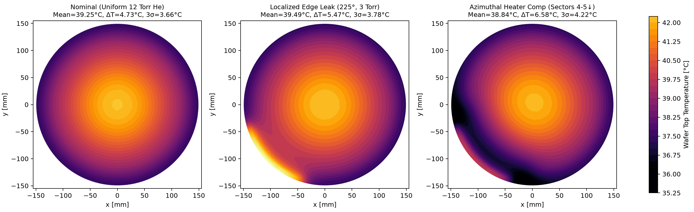

# 2장. 반도체 ESC 열전달 기초: 왜 일반 대류(h) 대신 '희박 헬륨'을 쓰는가?

## 1. 학습 목표 및 출발점

열전달 교과서의 고체 냉각은 대류($q'' = h(T_s - T_\infty)$)가 기본입니다. 하지만 식각 챔버는 진공이라 대류가 없고, 상면 복사($\varepsilon_{\text{Si}} = 0.65$)만으로는 $Q_{\text{plasma}} = 500\text{ W}$를 빼내기 부족합니다. 웨이퍼를 정전척(ESC)에 올려도 표면 거칠기 탓에 고체 접촉 열전달계수는 $h_{\text{solid}} = 50\ \text{W/m}^2\text{K}$에 그칩니다. 이 장에서는 **희박 헬륨 백사이드 냉각**의 원리와 코드 타협점을 정리합니다.

## 2. 핵심 개념 (3-Step 전개)

### ① 직관 비유: 1D 직렬 열저항과 '겉보기 간극 확장'

웨이퍼($t_w = 775\ \mu\text{m}$)에서 ESC 상면까지는 **고체 접촉($h_{\text{solid}}$)**과 **$d = 10\ \mu\text{m}$ 헬륨 전도**가 병렬 연결된 1D 열저항 회로입니다. 헬륨($k_{\text{He}} = 0.152\ \text{W/m}\cdot\text{K}$)은 $P \in [3.0, 20.0]\ \text{Torr}$ 저압에서 평균자유행로($\lambda$)가 $d$와 맞먹는 희박 영역에 들어갑니다. 벽면 충돌 부족으로 **온도 점프**가 생기며, 압력이 낮아질수록 $\lambda \propto 1/P$가 커져 **겉보기 간극이 $d + M(P)$로 확장**됩니다. 즉, 압력은 웨이퍼 아래 '열저항 밸브' 두께를 조절하는 스위치입니다.

에지 누설 시 $P_{\text{out}}$ 승압 보상은 **절대 금지($P_{\text{out}} \le P_{\text{out},0}$)**입니다. 누설부 과다 주입은 ① 정전 척킹력 급감과 웨이퍼 이탈(pop-off), ② 유출 헬륨의 파셴(Paschen) 방전 아킹, ③ $\text{Al}_2\text{O}_3$ 세라믹($k_{\text{cer}} = 30\ \text{W/m}\cdot\text{K}$) 열충격을 유발하기 때문입니다.

### ② 핵심 수식

$$h_{\text{eff}}(P, T) = h_{\text{solid}} + \frac{k_{\text{He}}}{d + M(P)}, \quad M(P) \propto \lambda \propto \frac{1}{P}$$

$$k_{\text{Si}}(T) = 148\left(\frac{300}{T}\right)^{1.3}, \quad \text{Bi}_z = \frac{h_{\text{eff}} t_w}{k_{\text{Si}}} \approx 0.009 \ll 0.1$$

$\text{Bi}_z \ll 0.1$은 두께 방향 온도차가 미미함을 뜻하며, 3D FEM을 2D 대리 모델로 축소하는 근거입니다.

### ③ 코드 구현과 3D FEM 결과 해석

`src/physics/materials_and_he.py`는 평균자유행로와 $M(P)$를 계산합니다.

```python
def h_eff_interface(
    P_torr: np.ndarray | float,
    d_gap: float = 10e-6,
    T_g: np.ndarray | float = 315.0,
    h_solid: float = 50.0,
    alpha_T1: float = 0.35,
    alpha_T2: float = 0.35,
) -> np.ndarray | float:
    """Kennard-Yovanovich rarefied He gap + mesa solid contact conductance [W/(m^2*K)]."""
    P_arr = np.maximum(np.asarray(P_torr, dtype=float), 1e-12)
    T_arr = np.asarray(T_g, dtype=float)
    mfp = LAMBDA0_HE * (P0_HE_TORR / P_arr) * (T_arr / T0_HE)
    tac_factor = (2.0 - alpha_T1) / alpha_T1 + (2.0 - alpha_T2) / alpha_T2
    gas_factor = (2.0 * GAMMA_HE / (1.0 + GAMMA_HE)) / PR_HE
    M = tac_factor * gas_factor * mfp
```

`src/fem3d/esc_3d_fem_solver.py`는 압력 경계와 국소 누설을 $C^2$ 스무스스텝으로 정의합니다.

```python
def eval_he_pressure_3d(x: np.ndarray, y: np.ndarray, cond: ESC3DOperatingCondition) -> np.ndarray:
    """Evaluate C^2 compact-support backside He pressure P(r, theta) [Torr]."""
    r = np.hypot(x, y)
    s_r = quintic_smoothstep((r - (cond.r_he_split_m - 0.5 * cond.w_smooth_m)) / cond.w_smooth_m)
    p_base = (1.0 - s_r) * cond.p_he_in_torr + s_r * cond.p_he_out_torr

    if cond.beta_leak >= 1.0 - 1e-12:
        return p_base

    l_r = quintic_smoothstep((r - cond.r_leak_m) / cond.w_smooth_m)
    if cond.leak_theta_halfwidth_deg >= 180.0:
        l_theta = np.ones_like(r)
    else:
        theta_deg = np.degrees(np.arctan2(y, x)) % 360.0
        dtheta = np.abs(((theta_deg - cond.leak_theta_center_deg + 180.0) % 360.0) - 180.0)
```



위 3D FEM 결과에서 좌측 정상(12 Torr, $\Delta T = 4.73^\circ\text{C}$) 대비 중앙의 225° 누설(12→3 Torr)은 $M(P)$ 급증으로 **`+5.85°C` 핫스팟**($\Delta T = 5.47^\circ\text{C}$)을 만듭니다. 우측처럼 섹터 4~5 히터만 수동 하향하면 주변이 과냉각되어 `ΔT`가 **`5.47°C → 6.58°C`**로 악화됩니다.

## 3. 교과서 이상 모델 vs 현재 코드의 타협점

> [!NOTE]
> **교과서 이상 모델 대비 현재 코드의 3가지 타협점**
> 1. **기체 온도 고정(`T_g = 315.0 K`):** 국소 평균 온도 $(T_w + T_{\text{ESC}})/2$ 대신 상수 `315 K`로 간극을 평가합니다.
> 2. **가상 직교이방성 계면층($t_{\text{gap,mesh}} = 0.2\ \text{mm}$):** $d = 10\ \mu\text{m}$ 직접 메쉬화 시 종횡비가 폭발하므로, $0.2\ \text{mm}$ 가상층에 $k_z = h_{\text{eff}} t_{\text{gap,mesh}}, k_{xy} \approx 0$을 부여해 수직 열저항만 보존합니다.
> 3. **표면 계수 상수화:** 열적응계수(`alpha_T = 0.35`)와 방사율($\varepsilon_{\text{Si}} = 0.65$)을 상수로 고정했습니다.

## 4. 3줄 요약 및 면접 자가 점검 퀴즈

1. 진공 챔버에서는 $10\ \mu\text{m}$ 간극의 희박 헬륨 온도 점프 $M(P) \propto 1/P$로 겉보기 간극과 열저항을 제어합니다.
2. 225° 누설(12→3 Torr)은 `+5.85°C` 핫스팟을 만들지만, 척킹력 급감·파셴 아킹·열충격 때문에 $P_{\text{out}}$ 승압은 금지됩니다.
3. 3D FEM은 `T_g = 315 K`, `alpha_T = 0.35`, $0.2\ \text{mm}$ 가상 직교이방성 층으로 안정성과 정확도를 확보합니다.

**면접 퀴즈:** 225° 누설 시 ① $P_{\text{out}}$ 승압이 금지되는 이유와 ② 인접 히터만 수동 하향해도 `ΔT`가 악화되는 이유를 설명하시오.

<details>
<summary>정답 및 해설 보기</summary>

1. **$P_{\text{out}}$ 승압 금지:** 누설 유량 급증으로 척킹력이 급감해 웨이퍼 이탈이 발생할 수 있고, 유출 헬륨이 파셴 아킹과 $\text{Al}_2\text{O}_3$ 열충격을 유발합니다.
2. **수동 하향 실패:** 세라믹 횡방향 열확산 때문에 국소 핫스팟은 다 못 잡으면서 주변 정상부만 과냉각시켜 `ΔT`가 `5.47°C → 6.58°C`로 커집니다.

</details>
