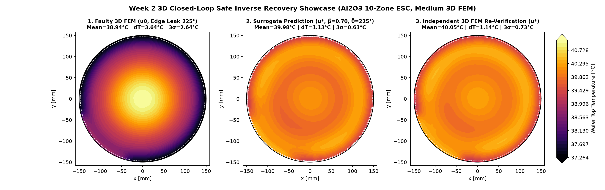

# 3장. 속도 27배의 비밀: 선형 ESC ROM(중첩의 원리) + 2D 극좌표 FVM

## 1. 학습 목표 및 출발점

`medium` 3D FEM은 **20,956 DOFs**(119,765 요소)를 풀며 1회 **1,228.2 ms**가 걸립니다. 10존 히터($Q_1 \sim Q_{10}$)와 He 압력($P_{\text{in}}, P_{\text{out}}$)을 역설계하려면 수백 회 반복 해석이 필요해 3D FEM은 너무 느립니다. 이 장에서는 **중첩의 원리**, **Biot 수($\text{Bi}_z$)**, **유한체적법(FVM)**, **연립방정식 대입법**만으로 에너지 보존을 지키며 Forward를 **45.63 ms(26.9배 가속)**로 줄인 하이브리드 모델의 원리를 알아봅니다.

## 2. 핵심 개념 (3-Step 전개)

### Step 1. 선형 3D ESC(중첩의 원리)와 비선형 웨이퍼(2D 극좌표 FVM) 분리

세라믹 ESC와 베이스는 물성이 일정한 **선형 열전도 영역**입니다. **중첩의 원리**에 따라 ESC 상면에 $M = 82$개 극좌표 푸리에-반경 기저 열유속과 10개 히터($Q_1 \sim Q_{10}$) 단위 부하를 가한 3D FEM 응답을 **1회(13.88 s)** 추출해 영향행렬(Mode A ROM)로 저장하면, 이후 행렬 곱만으로 $T_{\text{ESC}}$를 복원합니다.

반면 웨이퍼는 $k_{\text{Si}}(T)$와 복사($T^4$)로 비선형이지만, 두께 $t_w = 775\ \mu\text{m}$의 Biot 수가 매우 작습니다.

$$\text{Bi}_z = \frac{h_{\text{eff}}\, t_w}{k_{\text{Si}}} \approx 0.009 \ll 0.1$$

집중용량 기준($\text{Bi} < 0.1$)을 만족해 상하면 온도차가 **0.057°C**뿐이므로, 에지 밀집 **2D 극좌표 FVM($24 \times 36 = 864$셀)**(`src/rom/esc_3d_unit_load.py`)과 조화평균 열전도도(`src/solvers/coupled_3d_wafer_fvm.py`)로 이산화합니다.

```python
def make_polar_fvm_grid(
    n_r: int = 24,
    n_theta: int = 36,
    r_wafer: float = 0.150,
) -> dict[str, np.ndarray]:
    """Build non-uniform radial (edge-clustered) x uniform angular 2D Polar FVM grid."""
    # Clustered radial faces: coarse [0, 105] mm, medium [105, 130] mm, fine [130, 150] mm
    n1 = max(int(round(n_r * 0.35)), 4)
    n2 = max(int(round(n_r * 0.25)), 4)
    n3 = n_r - n1 - n2
    r_faces = np.concatenate([
        np.linspace(0.0, 0.105, n1, endpoint=False),
        np.linspace(0.105, 0.132, n2, endpoint=False),
        np.linspace(0.132, r_wafer, n3 + 1),
    ])
```

```python
    def _wafer_conduction_and_rad(
        self,
        T_flat: torch.Tensor,
        opts: SolveOptions,
    ) -> torch.Tensor:
        """Compute net outward conduction + radiation power [W] for all N wafer cells."""
        T_2d = T_flat.reshape(self.n_r, self.n_theta)
        k = self._k_si(T_2d, opts.nonlinear_k_si)

        res = torch.zeros_like(T_2d)

        # 1. Radial interior faces (distance-weighted harmonic mean)
        k_l = k[:-1, :]
        k_r = k[1:, :]
        k_face_r = (k_l * k_r) / (self.w_r_right * k_l + self.w_r_left * k_r)
```

### Step 2. Schur 소거 = 연립방정식 대입법으로 $T_{\text{ESC}}$ 치환

웨이퍼 $T_w$와 ESC 상면 $T_{\text{ESC}}$는 계면 열전달 $h_{\text{eff}}(T_w - T_{\text{ESC}})$로 연성됩니다. **Schur 소거**는 본질적으로 **중고등학교 연립방정식 대입법**으로 $T_{\text{ESC}}$를 웨이퍼 식 안에 치환하는 과정입니다. 선형 ESC 식에서 정리한 $T_{\text{ESC}}$를 웨이퍼 비선형 식에 대입하면 미지수가 20,956개에서 **864개($T_w$)**로 줄어듭니다.

### Step 3. 에너지 보존과 26.9배 가속 검증

웨이퍼 전역 열수지 잔차는 **$1.14 \times 10^{-13}\text{ W}$**, ESC→칠러 열수지 잔차는 **$\le 9.09 \times 10^{-13}\text{ W}$**로 기계 정밀도 수준에서 에너지가 보존됩니다. 동일 워밍업 조건에서 Forward 시간은 **45.63 ms**로, `medium` 3D FEM(**1,228.2 ms**) 대비 **26.9배** 빠릅니다.



225° 누설 복구 결과에서 **Panel 2(Surrogate: `Mean=39.98°C, dT=1.13°C`)**와 **Panel 3(독립 3D FEM: `Mean=40.05°C, dT=1.14°C`)**은 평균 $0.07^\circ\text{C}$, $\Delta T$ $0.01^\circ\text{C}$ 차이로 온도 분포가 정밀하게 일치합니다.

## 3. 교과서 이상 모델 vs 현재 코드의 타협점

> [!NOTE]
> **박판 근사와 기저 절단의 트레이드오프**
> 1. **$\text{Bi}_z$ 박판 근사:** 웨이퍼 두께 방향 온도차(**0.057°C**)를 생략해 2D로 축소했으며, 정상 운전 시 3D FEM 대비 MAE는 **0.041°C**입니다.
> 2. **$M=82$ 기저 절단:** 유한 개수의 푸리에-반경 기저로 ESC 열유속을 투영하므로, 폭 **2 mm**의 날카로운 에지 누설 경계($r_{\text{leak}} \le 148\text{ mm}$)에서 고주파 성분이 절단됩니다. 이로 인해 225° 누설 시 전역 MAE는 **0.063°C**로 작지만 국소 최대 오차는 **0.357°C**가 발생하며, 이는 6장의 보수 마진($\delta_T, \delta_\nabla$)으로 흡수합니다.

## 4. 3줄 요약 및 면접 자가 점검 퀴즈

- **물리 분리:** 선형 3D ESC는 중첩의 원리($M=82$ 기저 + 10존 히터, 13.88 s 추출)로, 비선형 웨이퍼는 $\text{Bi}_z \approx 0.009 \ll 0.1$ 근거로 864셀 2D FVM으로 축소했습니다.
- **대입 소거:** Schur 소거(연립방정식 대입법)로 $T_{\text{ESC}}$를 웨이퍼 식에 치환해 미지수를 20,956개에서 864개로 줄였습니다.
- **성능 입증:** 열수지 $\le 9.09 \times 10^{-13}\text{ W}$, MAE 0.041~0.063°C를 유지하며 Forward **45.63 ms(26.9배 가속)**를 달성했습니다.

**면접 자가 점검 퀴즈:** 웨이퍼가 실리콘($t_w = 775\ \mu\text{m}$) 대신 두께 10 mm의 세라믹($k = 20\text{ W/m}\cdot\text{K}$)이고 $h_{\text{eff}} = 1,000\text{ W/m}^2\text{K}$라면, 2D 극좌표 FVM 가정이 여전히 유효할까요?

<details>
<summary>정답 및 해설 보기</summary>

**유효하지 않습니다.** 두께 방향 Biot 수가 $\text{Bi}_z = (1000 \times 0.01)/20 = 0.5 > 0.1$이 되어 웨이퍼 내부 전도 열저항이 계면 열저항과 맞먹게 됩니다. 상하면 온도 구배를 무시할 수 없으므로 2D 박판 가정이 붕괴하고 두께 방향 분할(3D 또는 다층 해석)이 필요합니다.

</details>
