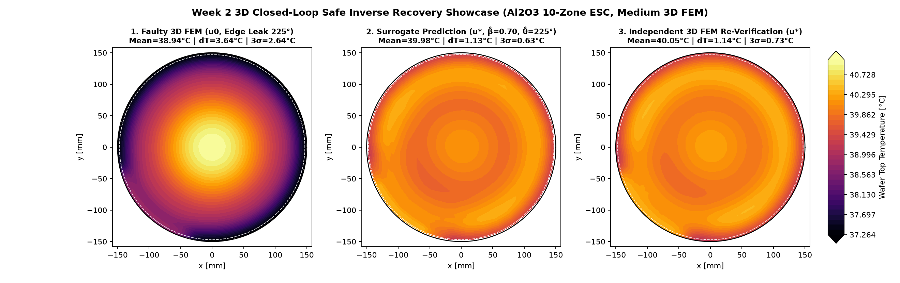
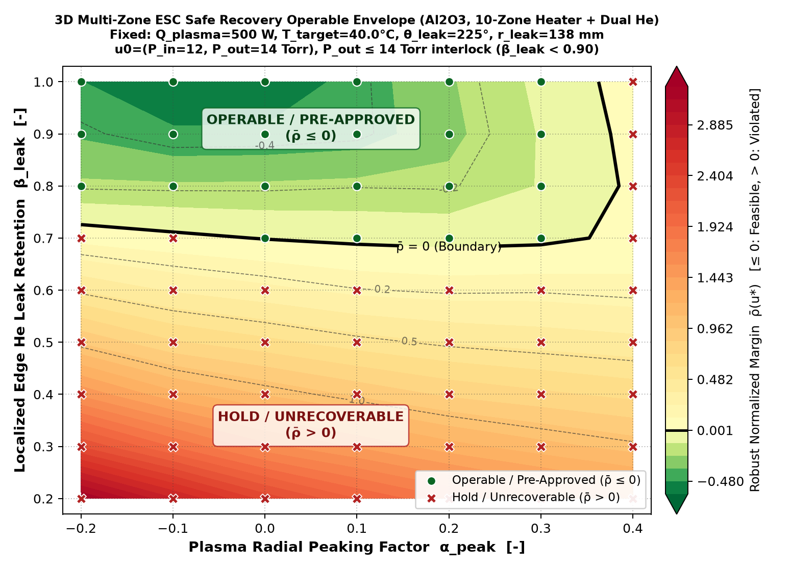

# Chapter 6. 안전 제약 역설계(SLSQP)와 통계적 안전 보증($A_{\text{pre}}$, $V$, Clopper–Pearson)

## 1. 학습 목표 및 출발점

Stage 1 진단 이후 **웨이퍼·설비 제약을 모두 지키는 10존 히터($Q_1 \sim Q_{10}$)와 He 압력($P_{\text{in}}, P_{\text{out}}$)을 역설계하고, 실제 3D FEM 기준 안전성을 통계 보증하는 방법**을 정리합니다.

## 2. 핵심 개념 (3-Step 전개)

### Step 1. SLSQP 제약 최적화와 7대 안전·품질 제약

Stage 2는 12차원 제어량 $\mathbf{u} = [Q_1,\dots,Q_{10}, P_{\text{in}}, P_{\text{out}}]$를 SLSQP로 최적화합니다. 대리 모델–3D FEM 오차(MAE `0.041°C`)를 방어하려 보수 마진($\delta_T = 0.06$ °C, $\delta_\nabla = 0.04$ °C/mm)을 **사전 승인용 웨이퍼 4대 규격**에만 선제 반영합니다.

* **웨이퍼 4대 규격 ($r \le 147$ mm):** $|T_{\text{mean}} - 40.0| \le 0.5$ °C, $dT \le 1.5$ °C, $3\sigma \le 1.0$ °C, $|\nabla T| \le 0.3$ °C/mm (사전 승인식만 $\delta_T, \delta_\nabla$ 차감).
* **설비 제약 및 누설 압력 잠금:** 세라믹 구배($r \le 155$ mm) $\le 1.5$ °C/mm, $Q_{\text{cool}}$($r \le 160$ mm) $\le 1800$ W, $|\Delta q''| \le 2.5$ W/cm²를 강제하며, 누설 감지 시 `p_out_hi = p_out_0`으로 $P_{\text{out}}$을 잠가 누설 악화를 막습니다.

최적해 $\mathbf{u}^*$의 최악 위반도 추정 상계 $\overline{\rho}(\mathbf{u}^*) \le 0$이면 사전 승인($A_{\text{pre}} = 1$), $\overline{\rho}(\mathbf{u}^*) > 0$이면 보류(`Hold`, $A_{\text{pre}} = 0$)로 동결합니다.

```python
# src/inverse/stage2_3d_recovery.py (L50-L64)
class RecoverySpec:
    """Product quality & equipment safety specifications for Stage 2."""
    T_target_C: float = 40.0
    r_eff_m: float = 0.147

    # Conservative FVM-to-3D-FEM-top margins (1.5x medium MAE=0.041C; ONLY for pre-approval, NEVER post-hoc V)
    delta_T_C: float = 0.06
    delta_grad_C_per_mm: float = 0.04

    # Product quality limits on r <= 147 mm
    limit_mean_err_C: float = 0.50
    limit_dT_span_C: float = 1.50
    limit_3sigma_C: float = 1.00
    limit_wafer_grad_C_per_mm: float = 0.30
```

### Step 2. 3D 폐루프 복구 쇼케이스와 운전 가능 영역



225° 누설($\beta_{\text{leak}} = 0.70$) 사례입니다. 왼쪽 고장(`u0`)은 에지 냉각 저하로 무너지지만, 추정($\hat{\beta}=0.6958, \hat{\theta}=225.15^\circ$) 후 도출한 $\mathbf{u}^*$는 중앙 대리 모델(`dT = 1.13°C`)과 오른쪽 독립 3D FEM이 $r \le 147$ mm에서 일치합니다. 3D FEM 기준 $dT$ **`3.64→1.14°C`(-68.6%)**, $3\sigma$ **`2.64→0.73°C`(-72.2%)**, 평균 **`38.95→40.05°C`**로 회복되었습니다.



63개 운전점($\alpha_{\text{peak}} \in [-0.2, 0.4]$, $\beta_{\text{leak}} \in [0.2, 1.0]$) 중 초록 원($\overline{\rho} \le 0$) **22/63건**만 복구 가능하며 검은 실선($\overline{\rho} = 0$)이 경계입니다. $\alpha_{\text{peak}} \in [0.00, 0.30]$에서 최소 복구 잔존율은 이산 **`0.70`**, 보간 **`0.6819`**(약 32% 손실)이며, 아래 빨간 X는 `Hold` 됩니다.

### Step 3. 시험 답안지 비유($A_{\text{pre}}$ vs $V$)와 동전 던지기(Clopper–Pearson)

* **시험 답안지 비유:** Stage 2가 대리 모델·보수 마진만으로 답안지($A_{\text{pre}}, \mathbf{u}^*$)를 먼저 동결 제출하고, 독립 3D FEM이 순수 4대 규격으로 위반 $V \in \{0, 1\}$을 채점해 데이터 누수를 막습니다.
* **동전 던지기 비유:** Phase 1.5 독립 87건 배치에서 $H_{\text{block}}$(4/4)·OOD(6/6)·극심 누설(5/5)을 100% 차단한 뒤 승인된 $n_A = 68$건 중 위반은 **0건**(`0.00%`)이었습니다. 위반 확률 $p$인 동전을 68번 던져 모두 안전할 확률 $(1-p)^{68} = 0.05$에서 95% Clopper–Pearson 상한은 $1 - 0.05^{1/68} = 0.0431 < 5\%$입니다.

```python
# benchmarks/phase15_verification_suite.py (L92-L100)
def clopper_pearson_upper_95(k: int, n: int) -> float | None:
    """One-sided 95% Clopper-Pearson upper confidence bound for binomial rate k/n."""
    if n <= 0:
        return None
    if k == 0:
        return float(1.0 - 0.05 ** (1.0 / n))
    if k >= n:
        return 1.0
    return float(beta_dist.ppf(0.95, k + 1, n - k))
```

## 3. 교과서 이상 모델 vs 현재 코드의 타협점

> [!NOTE]
> **국소 SLSQP의 `Hold`와 유한 시나리오 $\overline{\rho}(\mathbf{u}^*)$**
> 1. **왜 $\overline{\rho} > 0$을 PM 확정이 아닌 `Hold`로 두는가?** SLSQP는 국소(local) 탐색기여서 전역 실행불가능성 증명이 아니므로 보수적으로 `Hold` 표기합니다.
> 2. **왜 $\overline{\rho}(\mathbf{u}^*)$는 추정 상계인가?** 연속 불확실성 대신 유한 시나리오 최댓값으로 근사하며, $\delta_T, \delta_\nabla$와 독립 3D FEM 배치 검증으로 보완합니다.

## 4. 3줄 요약 및 면접 자가 점검 퀴즈

1. Stage 2 SLSQP는 $\delta_T, \delta_\nabla$가 반영된 웨이퍼 4대 규격, 설비 3대 제약, 누설 $P_{\text{out}}$ 잠금을 만족하는 $\mathbf{u}^*$를 역설계합니다.
2. 225° 누설 3D FEM $dT$를 `3.64→1.14°C`(-68.6%)로 회복했고, 63pt 중 22건 복구 경계($\beta_{\text{leak}} \ge 0.6819$, 이산 `0.70`)를 규명했습니다.
3. $A_{\text{pre}}$ 동결 후 3D FEM 채점($V$) `0/68` 무위반으로 95% Clopper–Pearson 상한 `4.31%`(< 5%)를 입증했습니다.

**면접 자가 점검 퀴즈:** 사전 승인($A_{\text{pre}}$)에는 $\delta_T = 0.06$ °C를 적용하면서, 왜 사후 3D FEM 채점($V$)에는 $\delta_T$를 빼지 않고 순수 규격으로 판정해야 할까요?

<details>
<summary>정답 및 해설 보기</summary>

$\delta_T$는 대리 모델 오차(MAE `0.041°C`)를 방어하려 사전 설계에만 넣는 안전율입니다. 사후 3D FEM 채점까지 $\delta_T$만큼 깎으면 실제 규격($dT \le 1.5$ °C)을 만족한 정상 웨이퍼도 위반으로 오판하게 됩니다.

</details>
